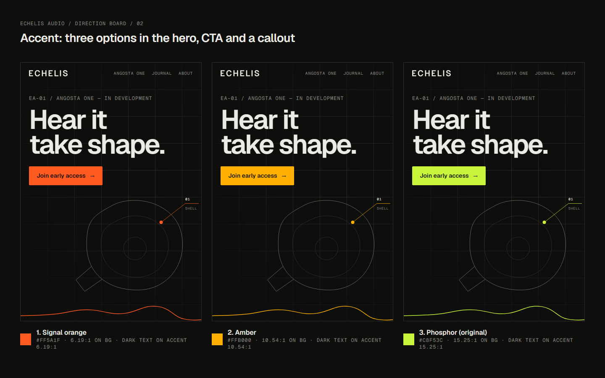
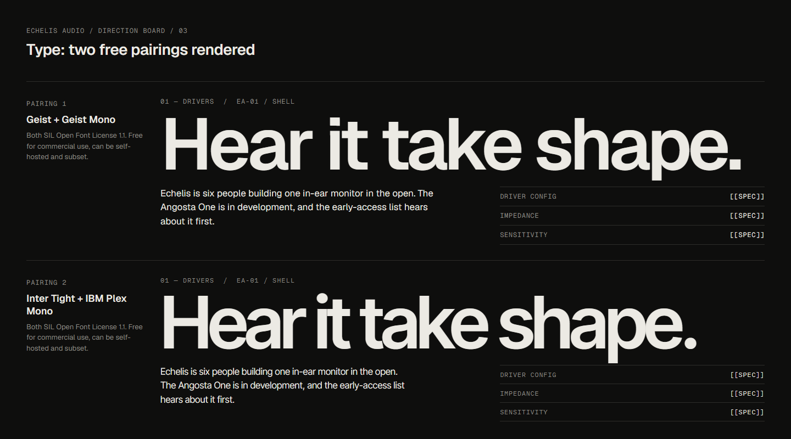
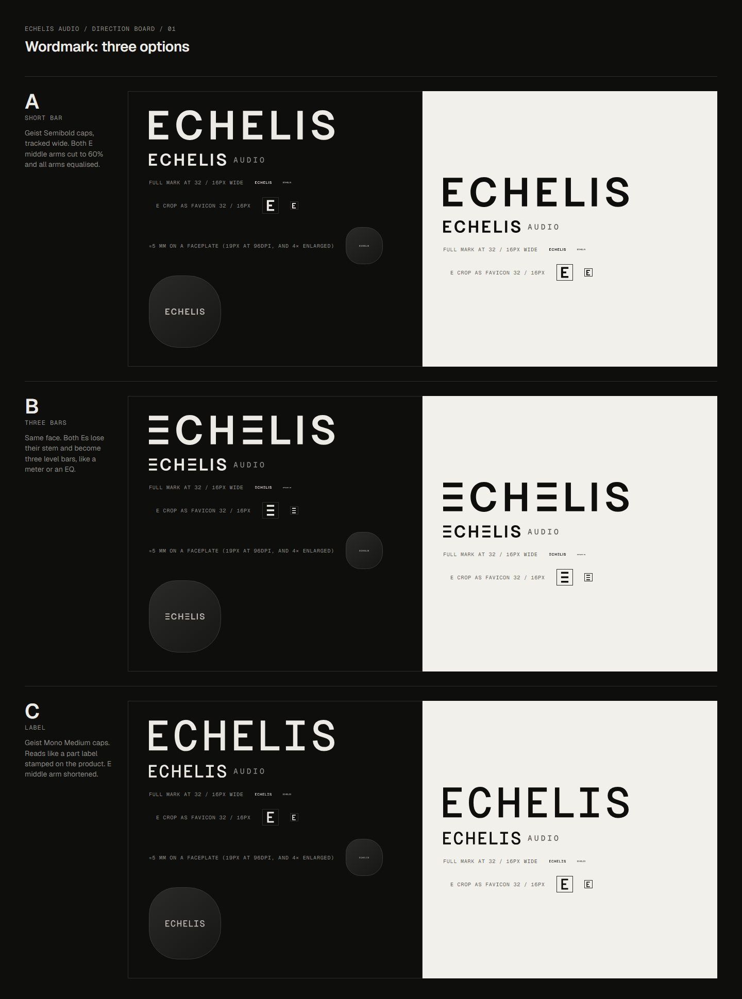

# Echelis Audio: Phase 1 creative direction ("Instrument")

Status: proposal, awaiting approval of **type, colour and wordmark together**. Nothing here is built into the site yet.

Rendered boards live in `docs/direction/` (open the `.html` files in a browser for full quality):

- `wordmarks.html` / `wordmarks.png`
- `accents.html` / `accents-1440.png`
- `type.html` / `type.png`

## 1. Concept

**The site is the instrument's manual.** Echelis is six people building one object. The site should read like the engineering document for that object: ruled, numbered, exact, and confident enough to leave most of the page empty.

Three rules carry the concept:

1. **Everything is labelled.** Sections have indices (`01 — DRIVERS`), parts have numbers (`EA-01 / SHELL`), values sit in spec rows. Unknown values are shown as unknown, not hidden.
2. **One signal.** A single accent colour, used on at most 5% of any screen: the CTA, the active state, the callout dot, the frequency line.
3. **One moving part.** The product is the only thing that animates with any drama. Everything else moves like a switch: short, straight, no bounce.

My recommendations, in one line: **wordmark A, Geist + Geist Mono, amber accent.** Reasons are in each section.

## 2. Colour

### Base tokens

Contrast ratios are computed (WCAG 2.x relative luminance), not estimated.

| Token | Value | Use | On `--bg` | On `--surface` |
|---|---|---|---|---|
| `--bg` | `#0E0E0D` | page base | — | — |
| `--surface` | `#1A1A18` | cards, spec panels | — | — |
| `--line` | `#2E2D2A` | hairline rules, grid (decorative only) | 1.40:1 | — |
| `--line-strong` | `#6B6963` | input borders, focus-adjacent UI edges | 3.52:1 | 3.18:1 |
| `--text` | `#ECEAE4` | primary text | 16.05:1 | 14.49:1 |
| `--muted` | `#8C8A84` | labels, captions, part numbers | 5.60:1 | 5.05:1 |

- `--muted` passes AA (4.5:1) on both backgrounds, including at 11px.
- `--line` is too faint to carry meaning, which is correct for decorative rules. I added `--line-strong` because form-field borders need 3:1 (WCAG 1.4.11).
- Your starting values are unchanged; the only addition is `--line-strong`.

### Accent options

| # | Name | Value | As text/line on `--bg` | On `--surface` | Dark text on accent (CTA) | White text on accent |
|---|---|---|---|---|---|---|
| 1 | Signal orange | `#FF5A1F` | 6.19:1 | 5.59:1 | 6.19:1 | 3.12:1 (fails) |
| 2 | Amber | `#FFB000` | 10.54:1 | 9.51:1 | 10.54:1 | 1.83:1 (fails) |
| 3 | Phosphor (original) | `#C8F53C` | 15.25:1 | 13.76:1 | 15.25:1 | 1.27:1 (fails) |

All three pass AA as text, as a line, and as a CTA background with `--bg`-coloured text. **CTA text is always dark**; white on any of them fails.

- **Signal orange** has the most energy, and is the colour most associated with Teenage Engineering. It is the option most likely to read as a clone.
- **Amber** is the colour of VU meters, tube glow and panel lamps. It sits naturally in a warm near-black palette and has the highest "audio" association without belonging to another brand.
- **Phosphor** is my original proposal: the yellow-green of an oscilloscope or analyser trace. It ties directly to the frequency-curve motif and is the most visible of the three. The risk is that acid green on black is common on tech sites right now.

**Recommendation: amber.** It is warm where the palette is warm, it means "audio" without quoting anyone, and it leaves orange to the brand we are learning from.

On light backgrounds none of the accents pass as text (best is orange at 2.74:1 on `#F2F0EA`). On light surfaces the accent is used only as a fill behind dark text, never as text.

## 3. Typography

| # | Display + body | Labels / specs | Licence |
|---|---|---|---|
| 1 | **Geist** | **Geist Mono** | Both SIL Open Font License 1.1. Free for commercial use; may be self-hosted, subset and modified. |
| 2 | **Inter Tight** | **IBM Plex Mono** | Both SIL OFL 1.1. Same freedoms. |
| 3 | **Söhne** | **Söhne Mono** | Commercial (Klim Type Foundry). Needs a paid web licence, priced by traffic. Not rendered here because I can't load it without a licence. |

- **Pairing 1** was drawn as a matched pair, so the mono shares proportions with the grotesk. It holds up at very large sizes and has distinctive but quiet letterforms.
- **Pairing 2** is tighter and more neutral. Plex Mono has more personality (slab-like details), which can fight the display face.
- **Pairing 3** is the premium option if you later want a typeface fewer sites use.

**Recommendation: pairing 1.** It is free, matched, and the wordmark options below are drawn from it, so the logo and the site share a skeleton.

### Type scale (tokens)

| Token | Size | Line height | Tracking | Use |
|---|---|---|---|---|
| `--type-display` | `clamp(3.25rem, 15vw, 15rem)` | 0.9 | −0.05em | hero headline, ≤ 6 words |
| `--type-h2` | `clamp(2rem, 5vw, 4.5rem)` | 1.0 | −0.035em | section headlines |
| `--type-h3` | `1.5rem` | 1.2 | −0.015em | card and callout titles |
| `--type-body-l` | `1.25rem` | 1.45 | 0 | lead paragraphs |
| `--type-body` | `1.0625rem` | 1.55 | 0 | body, max 62 characters per line |
| `--type-label` | `0.75rem` | 1.3 | 0.08em, uppercase | mono labels, spec keys and values |
| `--type-label-s` | `0.6875rem` | 1.3 | 0.1em, uppercase | part numbers, indices (11px floor) |

Weights: display and headings 600, body 400, labels 500. Fonts will be self-hosted, subset to Latin, preloaded, with `font-display: swap`.

## 4. Wordmark

All three are **outlined vector paths** with no font dependency. Each is shown on `--bg`, on a light background, with the "ECHELIS AUDIO" lockup (AUDIO in the mono face), at 32px and 16px wide, and at about 5 mm wide on a faceplate.

| | Name | Construction | Custom detail |
|---|---|---|---|
| **A** | Short bar | Geist Semibold caps, tracked wide | Both Es redrawn: top and bottom arms equalised, middle arm cut to 60% |
| **B** | Three bars | Same face | Both Es lose their stem and become three level bars, like a meter |
| **C** | Label | Geist Mono Medium caps | E middle arm shortened; reads like a stamped part label |

**Spacing.** Letters are placed by the gap between shapes, not by the font's default advance. Straight-to-straight pairs (H–E) get the full gap. Pairs with an open or round side get less: E–C 80%, C–H 86%, E–L 90%, L–I 72% (the L's empty corner), I–S 90%.

**What the small sizes show:**

- A seven-letter wordmark is **not legible at 16px or 32px wide** in any option. That is a property of the name's length, not of the drawing. For favicons I propose the wordmark's **E, cropped**, as shown. It is a letter from the mark, not a new symbol, so it leaves room for a symbol later.
- At 5 mm on a faceplate, each letter is roughly 0.5 mm wide. Whether that survives depends on the marking process (laser, pad print, engraving). **A** has the heaviest, simplest strokes and is the safest. **B**'s bars may fill in. This needs a physical test before the faceplate is committed.

**Recommendation: A.** It is the most legible, the most durable in print, and its custom E is quiet enough to last. **B** is the most ownable, but "ΞCHΞLIS" is a familiar trick and slows reading. If you like B's bars, they are a strong candidate for the future symbol rather than for the wordmark itself.

Deliverables once an option is approved: final SVGs (primary and secondary lockups, dark and light), favicon set, and the Open Graph image.

## 5. Motion

Deliberate and mechanical: dials and switches, never springs.

| Token | Value | Use |
|---|---|---|
| `--ease-mech` | `cubic-bezier(0.2, 0, 0, 1)` | default: fast start, firm stop |
| `--ease-switch` | `cubic-bezier(0.6, 0, 0.2, 1)` | state changes (toggles, tabs) |
| `--dur-1` | `120ms` | hover, focus, small state changes |
| `--dur-2` | `240ms` | reveals, menu, form states |
| `--dur-3` | `480ms` | section transitions, line draws |
| `--dur-4` | `900ms` | hero settle, signup success line |

- No overshoot, bounce or elastic easing anywhere.
- Elements move on one axis at a time, over short distances (≤ 24px), or draw along a line.
- The scroll sequence is scrubbed by scroll position, with a "detent" at each callout: the model holds still while the label is readable.
- **`prefers-reduced-motion`:** the scroll sequence is replaced by a static exploded diagram with all five callouts visible; no scrubbing, no parallax, no line-draw. Remaining transitions are opacity only, ≤ 120ms.

## 6. Written moodboard

| Reference | What we take | What we deliberately don't |
|---|---|---|
| **Teenage Engineering** | Tiny labels next to large type; spec-sheet grids and rules; numbered callout diagrams; one loud colour as a signal; play inside strict structure | Their light grey palette, their orange, their custom typeface, their lowercase voice, their layouts |
| **Igloo Inc** | Scale; 3D bound to scroll that stays easy to navigate; very few words | Full-screen WebGL as the whole site; long load before any content |
| **Opal Tadpole** | One hero product; clean 3D; a small company presenting like a large one | A store-first layout; we have nothing to sell yet |
| **Lusion (EverSwap), Fauna Robotics** | Premium object lighting; deliberate, weighted motion | Heavy post-processing and effects that cost mobile performance |

Echelis's own contribution: the **dark inversion**, the **frequency line** as a recurring signature, and **honest unknowns** (visible `[[SPEC]]` rows become "to be measured" in the design, which fits a company building in the open).

## 7. Home page wireframe

| # | Section | Content | Notes |
|---|---|---|---|
| 0 | **Header** | Wordmark top-left. Nav: Angosta One, Journal, About. CTA: "Join early access". | Sticky, hairline bottom rule. Mobile: wordmark and CTA only; nav in a sheet. |
| 1 | **Hero** | Mono label `EA-01 / ANGOSTA ONE — IN DEVELOPMENT`. Display headline. One CTA. 3D model right/behind, ruled grid visible. | A static poster image renders first (this is the LCP element, eager-loaded). The 3D canvas loads lazily and replaces it with no layout shift. |
| 2 | **Scroll sequence** | Model rotates, separates into the exploded view, five numbered callouts, reassembles. | Pinned section. One callout readable at a time. Static diagram fallback for reduced motion, no WebGL, and no JS. |
| 3 | **Spec sheet** | `02 — SPECIFICATION`. Two-column ruled grid of key/value rows. | All values `[[SPEC]]` until confirmed; shown in the UI as "to be measured". |
| 4 | **Why Echelis** | `03 — WHY`. Three short beats, each a mono index, a 3–5 word headline, one sentence. | No icons. Rules between beats. |
| 5 | **Team / story** | `04 — TEAM`. Two sentences and a link to About. Six-person roster as a label row. | Founded July 2026. |
| 6 | **Early access** | `05 — EARLY ACCESS`. Headline, email field, CTA, one line of consent text. | The frequency line animates on success. Links to `/thanks` without JS. |
| 7 | **Footer** | Wordmark, nav, contact email, legal links, `© 2026 Echelis Audio`. | Frequency line as the top divider. |

### Exploded-view callouts (draft copy, plain language)

| # | Label | Line |
|---|---|---|
| 01 | `EA-01 / SHELL` | The body. It sits in the bowl of your ear and holds everything else. |
| 02 | `EA-02 / FACEPLATE` | The outer cover, and the part everyone else sees. |
| 03 | `EA-03 / NOZZLE` | The short tube that carries sound into your ear. The ear tip fits over it. |
| 04 | `EA-04 / DRIVERS` | Tiny speakers. They turn the signal from your player into sound. |
| 05 | `EA-05 / CROSSOVER` | A small circuit that sends low, middle and high notes to the driver best suited to each. |

### Headline candidates (≤ 6 words; copy placeholders)

1. "Hear it take shape." (used in the boards)
2. "Six people. One monitor."
3. "Built in the open."

## 8. Rendering: why Astro

- **Static HTML first.** Astro pre-renders every page to HTML at build time. The headline, copy and signup link exist without JavaScript, which meets the "readable with JS disabled" bar and fixes the empty-page problem from the audit.
- **Islands.** Only interactive pieces ship JavaScript. The 3D canvas is one island, loaded when it nears the viewport; the signup form is another. The rest of the page ships none.
- **Performance.** With a static poster image as the LCP element and the 3D deferred, the 2.5 s mobile LCP target is realistic. The current site cannot reach it because the image URL only exists after the bundle runs.
- **Content.** The journal becomes Markdown files in a content collection, with typed front-matter, instead of a hard-coded array.
- **Hosting.** Vercel builds Astro static output natively; the approved migration plan needs no change.
- **Alternatives considered.** Next.js would also work, but ships a larger client runtime for a site that is almost entirely static. Keeping Vite and adding a prerender step keeps the current SPA weight and the Base44 remnants.

3D library choices (Three.js directly, or React Three Fiber; GSAP ScrollTrigger; Lenis) and their weight are a Phase 2 decision, to be justified against the measured budget.

## 9. Alternate direction, in brief: "Listening room"

For comparison only. A warm, editorial site: off-white paper background, a serif display face, large still photography, no real-time 3D. The product is shown through photographs and one hand-drawn cutaway. Motion is limited to slow fades.

- **For:** fastest to build, lightest, most "audio heritage", lowest technical risk.
- **Against:** looks like many hi-fi brands; depends on photography of a product that does not exist yet; does less to make a six-person team read as a precise hardware company.

"Instrument" is the stronger fit for a pre-launch product, because diagrams and labelled unknowns work before there is anything to photograph.

## 10. Placeholders to fill

Specs (none invented; all open):

- `[[SPEC: driver config]]`
- `[[SPEC: frequency response]]`
- `[[SPEC: impedance]]`
- `[[SPEC: sensitivity]]`
- `[[SPEC: cable connector]]`
- `[[SPEC: shell material]]`
- `[[SPEC: faceplate finish]]`
- `[[SPEC: nozzle material]]`
- `[[SPEC: price]]`
- `[[SPEC: ship date]]`

Copy:

- Hero headline (three candidates above)
- The five callout lines
- "Why Echelis" three beats
- Team roster: six names and roles
- Part-number scheme: I used `EA-01` to `EA-05` following the example in the brief. Confirm or replace.

## 11. Open questions

1. **Wordmark:** A, B or C? Any changes to tracking or the E?
2. **Accent:** orange, amber or phosphor?
3. **Type:** pairing 1, 2 or 3?
4. **Callouts:** the crossover line assumes more than one driver type. You described the Angosta One as a hybrid, so I kept it. Confirm that is public.
5. **Faceplate marking:** which process will print or engrave the wordmark? That decides whether 5 mm is realistic.
6. **Headline:** pick one, or give me a direction to write more.

## Not included in this phase

- **Site screenshots at 1440px and 390px, and a Lighthouse report:** no site pages were built in this phase, by design. The boards above are rendered at 1440px. A 390px rendering of the hero comes with the Phase 2 build.
- **Final logo exports, favicon set and OG image:** produced once a wordmark is approved.
